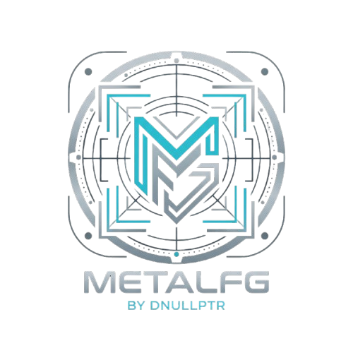

<div align="center">



# ⚡ MetalFG

### Real-Time GPU Frame Generation & Optical Flow Interpolation for ProMotion iOS Devices

[-007AFF?style=for-the-badge&logo=apple&logoColor=white)](https://github.com/dnullptr/MetalFG)
[-34C759?style=for-the-badge)](https://github.com/dnullptr/MetalFG)
[](https://github.com/dnullptr/MetalFG)
[](https://github.com/dnullptr/MetalFG)
[](https://github.com/dnullptr/MetalFG/releases/tag/nightly)

[](https://ko-fi.com/dnullptr)
[](https://paypal.me/dnullptr)

</div>

---

## 📖 Overview

**MetalFG** is a free, open-source, driver-level **GPU Frame Generation & Optical Flow Interpolation tweak** for rootless jailbreak environments (**Dopamine**, **Palera1n**) on 120Hz ProMotion devices (tested on iPhone 13 Pro Max on iOS 16; iPhone 14 Pro / Pro Max, iPad Pro, and iOS 15 ProMotion testers are very welcome!).

Inspired by PC frame generators like **Lossless Scaling (LSFG)**, **DLSS 3**, and **[MFG-SUPER-MOTION (SMFG)](https://github.com/NODIX-TECH/MFG-SUPER-MOTION)**, MetalFG intercepts 60 FPS (or 30 FPS) Metal games—such as *Genshin Impact*—and synthesizes true midpoint optical-flow frames directly on the Apple Silicon GPU to drive your 120Hz ProMotion display at a silky-smooth **120 FPS**.

> [!NOTE]
> **Beta Status:** MetalFG is still considered in **Beta** as we continue refining edge cases across different games and engines—however, the current **v2.3.0** release is by far our best, most accurate, and smoothest interpolation algorithm yet.

---

## 🎁 Why MetalFG is 100% Free & Open-Source Forever

**I will NEVER charge money for MetalFG.**

I spent a month of sleepless nights researching optical flow, debugging Metal swapchains, fighting ghosting and judder, and surviving Dopamine userspace-reboot bootloops on my personal iPhone 13 Pro Max to build a tweak that I would have happily paid for myself. It completely changed the way I enjoy my phone—making me happier with my 13 Pro Max than if I had just upgraded to a newer device.

Rather than wrapping this in DRM only to find it "cracked" on a Telegram group, I believe in giving this gem to the jailbreak community as a genuine **gift**.

### 🍺 Support, Contributions & Buying Me a Beer!

I study overtime, so my free time is super limited. Because MetalFG is **100% open-source**, community help is a huge opportunity:
- **Contributions, Ideas & Tips:** Have ideas to optimize the Metal compute shaders, refine optical flow, or add per-game profiles? PRs, issues, and tips are more than welcome!
- **Testers Wanted (including iOS 15!):** I haven't personally tested iOS 15 ProMotion devices yet—if you're on iOS 15 or testing different Metal games, I look forward to your feedback!
- **Donations:** If MetalFG breathes new life into your device the way it did for mine, and you'd like to buy me a beer (or half a beer! 🍺) for the month of research and debugging, I would be super grateful:

<div align="center">

[](https://ko-fi.com/dnullptr)
[](https://paypal.me/dnullptr)

</div>

---

## 🧠 Architecture (True 1-Frame Latency Midpoint Engine)

Unlike early frame extrapolators (`v1.0`) that tried to guess future frames and caused rubberbanding, **MetalFG** uses a **Full 1-Frame Latency True Midpoint Interpolation Pipeline** (`S_{N-0.5}` between `Frame N-1` and `Frame N`) with hardware-paced 120Hz `CARenderServer` VSYNC scheduling:

```
                                 [ Game Engine Render Loop ]
                                              |
                            (finishes rendering Native Frame N)
                                              |
                            [MTLCommandBuffer presentDrawable:]
                                              |
                       +----------------------v-----------------------+
                       |      MetalFG Command Buffer Interceptor      |
                       | - Suppresses premature unpaced presentation  |
                       | - Caches Ground Truth Frame N in private VRAM|
                       +----------------------+-----------------------+
                                              |
                 +----------------------------+----------------------------+
                 |                                                         |
     (VSYNC Tick 2k: 0.0ms)                                   (VSYNC Tick 2k+1: +8.33ms)
                 |                                                         |
                 v                                                         v
+----------------------------------------+       +-----------------------------------------+
|   Pass 1–3: Midpoint Synthesis S_{N-0.5}|      |   Pass 4: Ground Truth Frame N Blit     |
| - Coarse-to-Fine Optical Flow (80x45)  |       | - Triggered on next 120Hz DisplayLink   |
| - 5x5 Bilateral Fluid & Outlier Filter |       | - Blits cached Ground Truth Frame N     |
| - Sub-Block Silhouette Edge Resolver   |       | - Hardware-paced via afterMinimumDuration|
| - Clamped Catmull-Rom 5-Tap Sharp Read |       |   (8.33ms ProMotion 120Hz cadence)      |
+----------------+-----------------------+       +--------------------+--------------------+
                 |                                                    |
                 v                                                    v
   [ Synthetic Midpoint S_{N-0.5} ]                      [ Ground Truth Frame N ]
     (Displayed for 8.33ms @ 120Hz)                       (Displayed for 8.33ms @ 120Hz)
```

### Key Technical Highlights
1. **True Midpoint Bidirectional Interpolation (`Shaders/Shaders.metal`):**
   - Warps `Frame N` backward (`uv + effMV * t`) and `Frame N-1` forward (`uv - effMV * t`) to meet at the exact temporal midpoint ($t = 0.50$), ensuring every moving object advances in monotonic half-steps across every `8.33ms` 120Hz refresh cycle.
2. **SMFG 1.1 Coarse-to-Fine Optical Flow & Parabolic Sub-Pixel Fit:**
   - Evaluates a $3\times3$ RGB+Luminance patch across a 4-ring multi-radius seed search, followed by a **3-level hierarchical coarse-to-fine refinement** (`0.0040 -> 0.0020 -> 0.0009`) and **1D parabolic sub-pixel refinement** (`SubpelMain`).
3. **5x5 Bilateral Fluid Filter & Flat-Region Fill (`FillMain` + `EdgeMain`):**
   - Rejects isolated block outliers (`alone_near`) and propagates high-confidence motion from textured edges into flat/cel-shaded surfaces (e.g., anime skin, sky, indoor walls) while preserving sharp foreground/background boundaries.
4. **Sub-Block Edge Resolver & Foreground Silhouette Occlusion Guard (`Round 53`):**
   - Eliminates ghost halos around player heads and characters by testing the 4 surrounding macroblock vectors per pixel at motion boundaries and switching cleanly to the unoccluded frame when background motion crosses a slower foreground silhouette.
5. **Clamped Catmull-Rom 5-Tap Sharp Reconstruction & Static HUD Protection (`Round 56` + `MarkMain`):**
   - Restores sub-pixel texture crispness lost to bilinear filtering (without ringing) and locks static UI, text, damage numbers, minimaps, and skill icons in place.
6. **100% Dopamine Userspace-Reboot Safe (`Source/Tweak.xm`):**
   - Strictly whitelists third-party application bundles under `/var/containers/Bundle/Application/` before initializing any hooks—never injects into `SpringBoard`, `backboardd`, or system daemons.

---

## 🎛️ In-Game Floating HUD & Live Tuning Panel

MetalFG includes a draggable, touch-passthrough floating pill and frosted-glass tuning menu:
- **Live FPS Meter:** Shows real-time total, native, and synthetic FPS (`⚡ FG: 120 (60+60)`).
- **Single Tap Pill:** Toggle Frame Generation **ON / OFF** instantly with haptic feedback.
- **Double Tap Pill:** Minimize into a compact `36x36` dot.
- **Tap `⚙️` (or Long-Press):** Open the **Live Tuning Panel**:
  - **Presets:** `Clear` (tightest ghost rejection), `Balanced` (true 50% midpoint default), `Fluid` (widest bilateral motion blend).
  - **Sliders:** Live adjustment for *Motion Warp Scale*, *Ghost Rejection*, and *UI / HUD Protection*.

---

## 📦 Installation & Building

### Pre-Built Rootless `.deb`
Download the latest rootless `.deb` directly from [**GitHub Releases (Nightly)**](https://github.com/dnullptr/MetalFG/releases/tag/nightly) and install via **Sileo**, **Zebra**, or **Filza**.

### Building from Source (Theos)
```bash
make clean
make package THEOS_PACKAGE_SCHEME=rootless FINALPACKAGE=1
```
Generated package: `packages/com.dnullptr.metalfg_<version>_iphoneos-arm64.deb`
